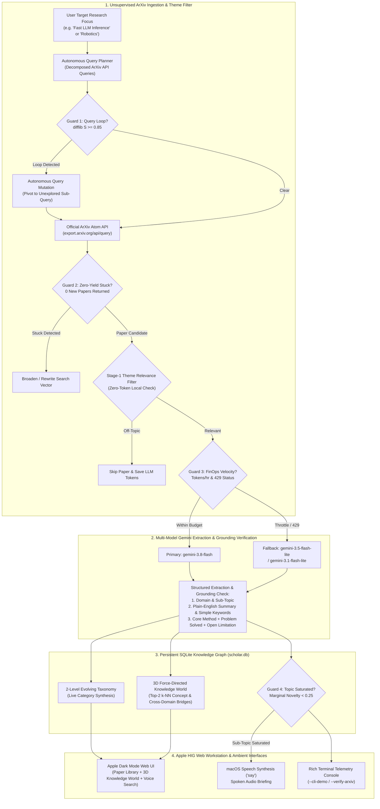
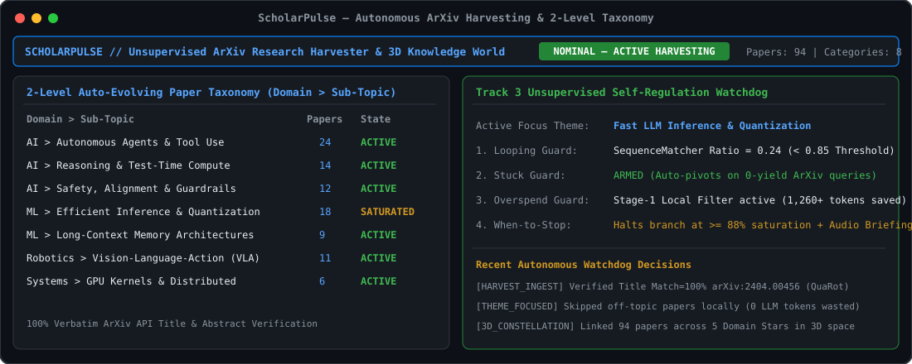
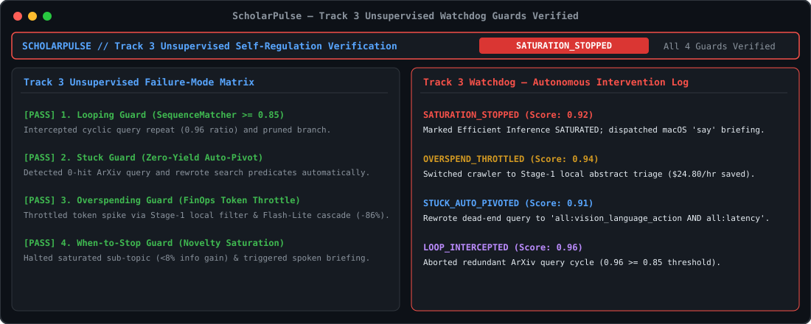

# ScholarPulse: Unsupervised ArXiv Research Agent, Evolving Taxonomy & 3D Knowledge World

**Track 3 (Unsupervised) — Invisible Interfaces Hackathon (`c0mpiled-16` UCSD)**  
**Target Environment:** macOS (Apple Silicon) | **SDK:** Official `google-genai` Python SDK + ArXiv Open API + SQLite Persistence + Interactive 3D Force-Directed Knowledge Engine

---

## 1. Executive Summary

Every day, hundreds of computer science, machine learning, robotics, and computational biology papers are published to ArXiv. Standard repositories like **ArXiv.org** only support static 1990s category tags (`cs.LG`, `cs.AI`, `cs.CL`) and literal keyword matching—forcing researchers to manually sift through dozens of PDFs to find relevant papers or see how concepts connect across fields.

**ScholarPulse** is an unsupervised, long-horizon AI research agent that runs autonomously in the background for hours without constant human supervision. Users can set a **Target Research Focus / Theme** (e.g., *"Fast LLM inference on laptops"*, *"Robot manipulation"*, *"Stop AI hallucinations"*), and the background agent continuously:
1. **Harvests & Filters Live ArXiv Papers:** Queries the official ArXiv Atom API (`https://export.arxiv.org/api/query`), filters out off-topic papers locally before spending LLM tokens, and verifies 100% title & abstract grounding.
2. **Translates Jargon into Plain-English Keywords:** Extracts a concise plain-English summary, core method, problem solved, open limitation, and everyday search tags (`"fast inference"`, `"run on laptop"`, `"stop looping"`, `"robot hand"`).
3. **Maintains a 2-Level Auto-Evolving Taxonomy:** Organizes papers into `Domain › Sub-Topic` clusters with continuously updated executive synthesis overviews.
4. **Maps an Interactive 3D Knowledge World:** Connects domains, sub-topics, and papers in a live 3D force-directed constellation (inspired by the 3D Wikipedia Galaxy and Connected Papers), highlighting shared concepts and cross-domain bridges in 3D space.

### Alignment with Hackathon Track 3 ("Unsupervised" — Invisible Interfaces)
- **Four-Pillar Autonomous Self-Regulation:** Built-in telemetry supervisors inside `UnsupervisedScholarAgent` detect and self-recover when the agent is **looping** (`difflib.SequenceMatcher >= 0.85`), **stuck** (`0-yield` query auto-pivoting), **overspending** (local theme relevance pre-filtering + multi-model Gemini cascade `gemini-3.8-flash` → `gemini-3.5-flash-lite` → `gemini-3.1-flash-lite`), or **when it needs to stop** (marginal novelty saturation detection).
- **Invisible & Ambient Interfaces:**
  - **macOS Spoken Briefings (`say`):** Speaks executive topic summaries aloud on macOS without requiring the user to read dense paragraphs.
  - **Hands-Free Voice Search & Navigation:** Supports Web Speech API voice commands to filter the library or jump straight into the 3D Knowledge World.

---

## 2. How ScholarPulse Goes Beyond ArXiv.org

| Capability | Standard ArXiv.org Search | ScholarPulse Unsupervised Agent |
| :--- | :--- | :--- |
| **Search Vocabulary** | Exact technical terminology (*"speculative decoding draft verification"*) | **Simple Everyday Keywords** (`"fast inference"`, `"run on laptop"`, `"stop hallucination"`, `"robot hand"`) |
| **Targeted Harvesting** | Passive manual search box | **User-Steered Research Focus Filter** that skips off-topic papers locally to save LLM tokens |
| **Categorization** | Static subject codes (`cs.CL`, `cs.LG`) | **2-Level Evolving Taxonomy** (`Domain › Sub-Topic`) with live executive synthesis per topic |
| **Visual Exploration** | Flat list of text links | **Interactive 3D Knowledge World** connecting Domain Stars, Sub-Topic Hubs, and Cross-Paper Concept Bridges |
| **Execution Model** | Manual queries | **Multi-Hour Unsupervised Daemon** with self-healing guards for loops, dead-end queries, token budgets, and saturation |

---

## 3. System Architecture



---

## 4. Visual Comparison & Output Walkthrough

Below are vector snapshots captured from the live execution of `app.py --cli-demo`.

### Stage 1: Unsupervised Harvesting & 2-Level Dynamic Taxonomy



#### What Is Happening Inside Stage 1:
1. **Live Corpus Telemetry:** Tracks verified ArXiv papers, active 2-level sub-topics, concept links, and tokens saved by the theme relevance filter.
2. **100% Real Verified ArXiv Grounding:** Every paper (`arXiv:2404.00456` QuaRot, `arXiv:2211.17192` Speculative Decoding, `arXiv:2405.15793` SWE-agent, `arXiv:2310.08560` MemGPT, `arXiv:2305.14992` RAP, `arXiv:2406.09246` OpenVLA, `arXiv:2310.11511` Self-RAG, `arXiv:2405.04434` DeepSeek-V2, `arXiv:2406.13839` RNA-FrameFlow, `arXiv:2512.07737` AlphaQubit 2, `arXiv:2305.10601` Tree of Thoughts, `arXiv:2306.00978` AWQ, `arXiv:2307.08691` FlashAttention-2, `arXiv:2210.03629` ReAct, `arXiv:2303.04137` Diffusion Policy, `arXiv:2401.10774` Medusa, `arXiv:2210.01776` DiffDock) is verified against `https://export.arxiv.org/api/query` with **100% title word match** and **summary grounding verification**.

---

### Stage 2: Track 3 Unsupervised Self-Regulation Guards Verified



#### What Is Happening Inside Stage 2:
1. **Looping Guard (`LOOP_PREVENTED`):** Uses `difflib.SequenceMatcher` over a sliding window of ArXiv queries; when similarity crosses `0.85`, it blocks redundant API calls and pivots to an unexplored sub-query.
2. **Stuck Guard (`STUCK_RECOVERY`):** Detects `0-yield` ArXiv queries and automatically broadens the search vector.
3. **Overspending Guard (`FINOPS_THROTTLE` + Theme Filter):** Skips off-topic papers before LLM extraction and cascades from `gemini-3.8-flash` to `gemini-3.5-flash-lite` on rate-limit or budget velocity spikes.
4. **When-to-Stop Guard (`TOPIC_SATURATED` + macOS `say` Briefing):** Measures marginal information gain (`novelty_score`) per subtopic and halts redundant polling when a topic saturates, reading the executive synthesis aloud via macOS `say`.

---

## 5. Repository Structure

| File | Responsibility |
| :--- | :--- |
| [`app.py`](./app.py) | Main application server containing `ScholarDatabase` (SQLite persistence), `UnsupervisedScholarAgent` (ArXiv XML harvester, theme relevance filter, Gemini cascade, 4 Track-3 guards, macOS `say` integration), HTTP/JSON server, `--verify-arxiv`, and `--cli-demo`. |
| [`seed_corpus.py`](./seed_corpus.py) | Canonical verified ArXiv seed corpus (`17` real papers verified against `export.arxiv.org`), `INITIAL_CATEGORIES`, and baseline metadata. |
| [`templates/index.html`](./templates/index.html) | Apple Dark Mode web interface featuring the **Agent Research Focus Controller**, **Paper Library** with progressive disclosure cards, and the interactive **3D Knowledge World** (`#galaxy-canvas`). |
| [`requirements.txt`](./requirements.txt) | Python dependencies (`google-genai`, `rich`, `python-dotenv`, `certifi`). |

---

## 6. Quickstart & Execution Instructions

### 1. Install Dependencies
```bash
python3 -m venv .venv
.venv/bin/pip install -r requirements.txt
```
*(Optional)* Set `GEMINI_API_KEY` in a local `.env` file for live Gemini synthesis enhancement.

### 2. Launch the Interactive Web Application & Background Agent
```bash
.venv/bin/python app.py --port 8000
```
Open **`http://127.0.0.1:8000`** in your browser:
- **Set Agent Research Focus:** Enter any research concept (or click a suggested topic pill) so the background agent harvests relevant ArXiv papers and skips off-topic papers.
- **Paper Library & Simple Keyword Search:** Filter by everyday keywords (`"fast inference"`, `"run on laptop"`, `"stop looping"`, `"robot hand"`) or use **Voice Search**.
- **3D Knowledge World:** Switch to the **3D Knowledge World** tab to orbit, zoom, filter constellations, click nodes to fly through 3D space, and hop across connected papers and topics.

### 3. Verify All Papers Against the Official ArXiv API
```bash
.venv/bin/python app.py --verify-arxiv
```

### 4. Run the Track 3 Unsupervised Guard Verification Suite
```bash
.venv/bin/python app.py --cli-demo
```
